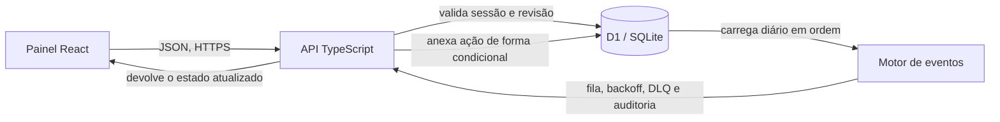

# Farol de Integrações

Um pedido chega ao ERP durante uma indisponibilidade. O Farol registra o evento, limita as retentativas e mantém o histórico quando o pedido precisa voltar da quarentena para a fila.

**[Abrir a demonstração](https://raphael-kaych.raphaelvindex.chatgpt.site/farol)** · [Portfólio](https://raphael-kaych.raphaelvindex.chatgpt.site/) · [Pesquisa de mercado](validacao-de-mercado.md) · [Execuções dos testes](https://github.com/raphaelkaych/farol-de-integracoes/actions)

## Teste em um minuto

1. Selecione **ERP instável**. Reenvie PC-1042 e confirme que há um evento único e um duplicado no histórico.
2. Execute três rodadas. Os retornos simulados são `503`, `503` e `200`, no relógio virtual `+0s`, `+30s` e `+90s`.
3. Selecione **ERP fora do ar** e execute três rodadas. O pedido vai para a DLQ, a fila de quarentena. Restaure o ERP, reprocesse a DLQ e execute mais uma rodada. O mesmo identificador chega ao destino com as quatro tentativas no histórico.

A demo roda sem cadastro e usa pedidos fictícios. O servidor registra cada ação no banco relacional. O relógio e as respostas do ERP são simulados.

## Arquitetura



- **Idempotência do evento.** Repetir o mesmo ID registra um reenvio no histórico sem abrir outro item na fila.
- **Concorrência da API.** Cada mutação envia a revisão que o painel leu. O SQL só acrescenta a próxima ação se essa revisão ainda for a mais recente. A chave composta de sessão e sequência reforça a regra. Uma disputa retorna `409` e o estado atual.
- **Retentativas e DLQ.** Atrasos de 30 e 60 segundos no relógio da demo, até três tentativas por ciclo. Reprocessar reinicia o ciclo de tentativas e preserva o ID e a contagem total.
- **Isolamento.** O servidor guarda só o hash do segredo da sessão. A sessão vence em duas horas e aceita até 32 ações. O primeiro acesso de uma nova sessão remove sessões vencidas e aplica o limite global da demo.

| Caminho | Conteúdo |
| --- | --- |
| [lib/farol/model.ts](lib/farol/model.ts) | Regras do fluxo e reconstrução do estado pelo diário |
| [lib/farol/store.ts](lib/farol/store.ts) | Consultas e escrita condicional no banco |
| [app/api/farol/route.ts](app/api/farol/route.ts) | Rota HTTP servida pelo Worker |
| [components/farol-panel.tsx](components/farol-panel.tsx) | Controles, fila e histórico no navegador |
| [drizzle/](drizzle/) e [tests/](tests/) | Migração versionada e testes com SQLite |

O escopo é um laboratório. A rodada é acionada por quem está testando, e a resposta do ERP vem do cenário. Uma integração real exigiria execução agendada, autenticação do emissor, armazenamento adequado ao volume e tratamento de falhas de rede fora da simulação.

## Rode localmente

Use Node.js 24 e npm. O Wrangler executa o Worker e fornece um banco D1 local.

```sh
npm ci
npm test
npm run typecheck
npm run build
node --import ./scripts/sites-env.mjs ./node_modules/wrangler/bin/wrangler.js d1 execute DB --local --config dist/server/wrangler.json --persist-to .wrangler/state --file drizzle/0000_farol_sessions.sql
npm start
```

Aplique a migração uma vez para cada banco local. Abra o caminho `/farol` no endereço impresso pelo Wrangler. O repositório também serve a página de portfólio e as demonstrações de Plantão de TI, Ponte ERP e Pulso da Operação.

## Contrato HTTP da demo

As chamadas usam `Content-Type: application/json` para POST. O corpo de uma ação tem até 1 KiB.

| Operação | Requisição | Retorno |
| --- | --- | --- |
| Iniciar | `POST /api/farol` com `{"action":"iniciar","scenario":"indisponivel"}` | `201`, token temporário e estado |
| Ler | `GET /api/farol` com `Authorization: Bearer <token>` | `200`, estado atual |
| Executar rodada | `POST /api/farol` com o token e `{"action":"rodada","version":0}` | `200`, estado novo, ou `409`, estado atual se outra ação chegou primeiro |

O CI no GitHub executa os testes de domínio e API, valida TypeScript e compila a aplicação. Os testes cobrem retentativas, reprocessamento, duplicidade, isolamento de sessão e duas escritas na mesma revisão.
