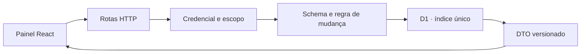

# ContractShield

O laboratório registra mudanças fictícias em três serviços. Mudanças em cobrança exigem janela noturna. O visitante escolhe um cenário e compara a expectativa com a resposta HTTP que o Worker realmente devolveu. [Demonstração](https://raphael-kaych.raphaelvindex.chatgpt.site/contractshield) · [Contrato OpenAPI](../public/contractshield.openapi.json)

| Fluxo | Evidência |
| --- | --- |
| Abrir sessão | Três credenciais temporárias para operador, leitor e operador externo. |
| Ler objeto | Escopo derivado da credencial em todas as consultas. Um objeto de outro escopo devolve 404. |
| Registrar | Perfil leitor recebe 403. Campos extras e janela inválida recebem 422. |
| Reenviar | O índice único por sessão, organização e chave mantém um ID em escritas concorrentes. Conteúdo diferente com a mesma chave devolve 409. |
| Ler versão 2 | O DTO acrescenta `revision`. O teste verifica a resposta nova contra os schemas das duas versões. |
| Limitar recursos | 2 KiB de corpo, 12 mudanças por organização e 36 chamadas por minuto da sessão. O limite de chamadas devolve 429 com `Retry-After`. |

A sessão dura 15 minutos. O banco guarda hashes das credenciais e limpa sessões expiradas ao admitir novas. A capacidade global é de 200 sessões. A autenticação da demo usa credenciais efêmeras emitidas ao visitante. Para uso multiusuário, a próxima fronteira é identidade verificável e orçamento de admissão por organização. [OWASP API1](https://api-security.owasp.org/editions/2023/en/0xa1-broken-object-level-authorization/) · [OWASP API3](https://api-security.owasp.org/editions/2023/en/0xa3-broken-object-property-level-authorization/) · [OWASP API4](https://api-security.owasp.org/editions/2023/en/0xa4-unrestricted-resource-consumption/)

## Reproduzir

Instale com `npm ci` e compile com `npm run build`. Execute `npm run test:e2e -- e2e/contractshield.spec.ts`. O Playwright inicia o Worker local e aplica a migração `0002_contractshield.sql` a um banco isolado. O Ajv valida respostas reais com os schemas da especificação. [Testes](../e2e/contractshield.spec.ts) · [Persistência](../lib/contractshield/store.ts)

O QualityGate compara assertivas de negócio entre duas variantes controladas. O Radar interpreta exemplos no navegador. O ContractShield exercita contrato HTTP, autorização, limites e persistência na própria API.
