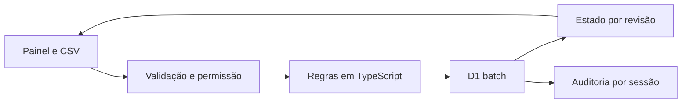

# LedgerFlow

[Demo pública](https://raphael-kaych.raphaelvindex.chatgpt.site/ledgerflow) · [Estudo de caso](https://raphael-kaych.raphaelvindex.chatgpt.site/projetos/ledgerflow) · [OpenAPI](../public/api-contract.json)

O sistema compara um extrato bancário fictício com lançamentos do sistema. A sessão de analista permite importar, criar, editar, remover e conciliar. A sessão de leitor pode consultar, filtrar e exportar o recorte. As alterações manuais ficam no histórico da sessão.

## Demonstração

1. Abra como **analista**, importe o CSV de exemplo duas vezes e observe o total de duplicados.
2. Rode **Conciliar agora**. LF-1001 fica conciliada. LF-1002 diverge no valor. LF-1003 e LF-1004 ficam sem par.
3. Filtre por estado, exporte o resultado e verifique o histórico. Crie um lançamento manual, ajuste o valor ou remova o lançamento para ver o cálculo anterior ser invalidado.
4. Abra como **leitor** para consultar uma sessão separada. A API rejeita escrita desse perfil com HTTP 403.

## Dados e regras

O CSV usa `id,referencia,origem,data,valor_centavos`. Cada linha usa um ID `B-101` ou `S-101`, uma referência `LF-1001`, origem `banco` ou `sistema`, data ISO e centavos inteiros positivos. São aceitas até 48 linhas e o formato não inclui campos livres ou colunas entre aspas. O cliente valida o arquivo antes de enviar, e o servidor valida novamente. Um ID idêntico é deduplicado. Qualquer ID com dados divergentes rejeita o lote antes da gravação.

Uma referência é conciliada quando tem exatamente um registro de cada origem, o mesmo valor e até dois dias de diferença. Mais de um lançamento de uma origem torna a referência ambígua. Uma alteração invalida a classificação anterior.

## Arquitetura

A API cria um token aleatório, guarda o hash do segredo e vincula o perfil ao banco. O [armazenamento](../lib/ledgerflow/store.ts) só atualiza a revisão esperada e grava a auditoria no mesmo lote transacional. A chave estrangeira elimina a auditoria quando uma sessão expirada é limpa. Duas alterações concorrentes na mesma revisão produzem uma escrita e um HTTP 409. As sessões expiram após duas horas.

## Execução e testes

Use o [setup do repositório](../README.md). `npm run test:e2e` aplica as migrações em um D1 local separado. Os [testes de domínio](../tests/ledgerflow.test.ts) exercitam importação e conciliação. A [suíte de laboratório](../e2e/laboratorios.spec.ts) exercita exportação, persistência, rejeição de escrita e concorrência pela API.

## Limites e evolução

A demonstração usa papéis temporários e um conjunto limitado de registros. Lançamentos importados são imutáveis na demo e o painel mostra as 12 operações mais recentes. Uma evolução para uso operacional inclui contas com identidade própria, aprovação de ajustes, tabelas de lotes e lançamentos, índices por organização e importações assíncronas.
