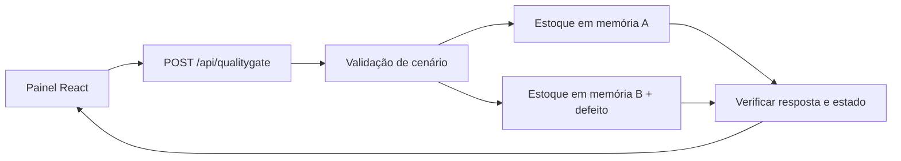

# QualityGate Studio

[Demo pública](https://raphael-kaych.raphaelvindex.chatgpt.site/qualitygate) · [Estudo de caso](https://raphael-kaych.raphaelvindex.chatgpt.site/projetos/qualitygate-studio) · [Execuções de CI](https://github.com/raphaelkaych/farol-de-integracoes/actions/workflows/validar.yml)

O serviço de reserva recebe um pedido, verifica permissão e saldo, e retorna o recibo de uma reserva já existente quando a operação é reenviada. A plataforma executa a mesma entrada em duas instâncias em memória e verifica a regra a partir dos códigos, do saldo e dos recibos produzidos.

| Cenário | Regra da implementação de referência | Resultado do defeito injetado |
| --- | --- | --- |
| Saldo insuficiente | HTTP 409, saldo 4 e zero reservas | HTTP 201, saldo −1 e uma reserva |
| Reenvio | HTTP 201 e 200, mesmo recibo, uma reserva | HTTP 201 duas vezes e dois recibos |
| Permissão | HTTP 403 e zero reservas | HTTP 201 para o perfil leitor |

## Arquitetura



O [motor TypeScript](../lib/qualitygate/engine.ts) contém o fluxo de reserva. A [rota HTTP](../app/api/qualitygate/route.ts) limita o corpo a 1 KiB e aceita os identificadores `stock`, `replay` e `role`. As duas variantes não compartilham estado.

## Execute e investigue

Siga o [setup do repositório](../README.md) com Node.js 24. Abra `/qualitygate` e execute um cenário. A API retorna HTTP 200 quando a comparação foi realizada. Os códigos mostrados nos cartões pertencem às operações de reserva.

```sh
node --test tests/qualitygate.test.ts
npx playwright test e2e/laboratorios.spec.ts -g QualityGate
```

O cenário de evidência verifica a autorização na variante com o defeito. O teste confirma que a versão defeituosa retornou 201 e então executa uma asserção que exige 403. Playwright registra a falha esperada, gera o trace e captura a tela. O pipeline falha se o teste não alcançar essa asserção, ou se passar inesperadamente. Abra o artefato `playwright-relatorio-e-traces` na execução do GitHub Actions. O trace pode ser aberto localmente com `npx playwright show-trace caminho/trace.zip`.

A comparação feita por um visitante é um experimento isolado. O relatório do pipeline tem data, commit e evidências da execução automatizada.

## Limites e próximos passos

Os pedidos e os perfis pertencem a um ambiente fictício. O serviço perde o estado ao final da comparação. O próximo caso de maior valor é estoque compartilhado, com duas requisições concorrentes e garantia de que nenhuma reserva exceda a disponibilidade.
