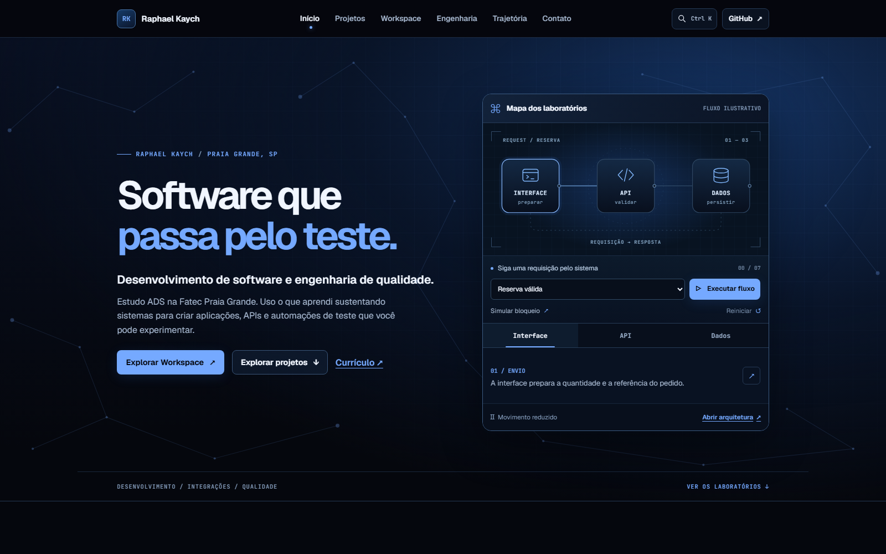
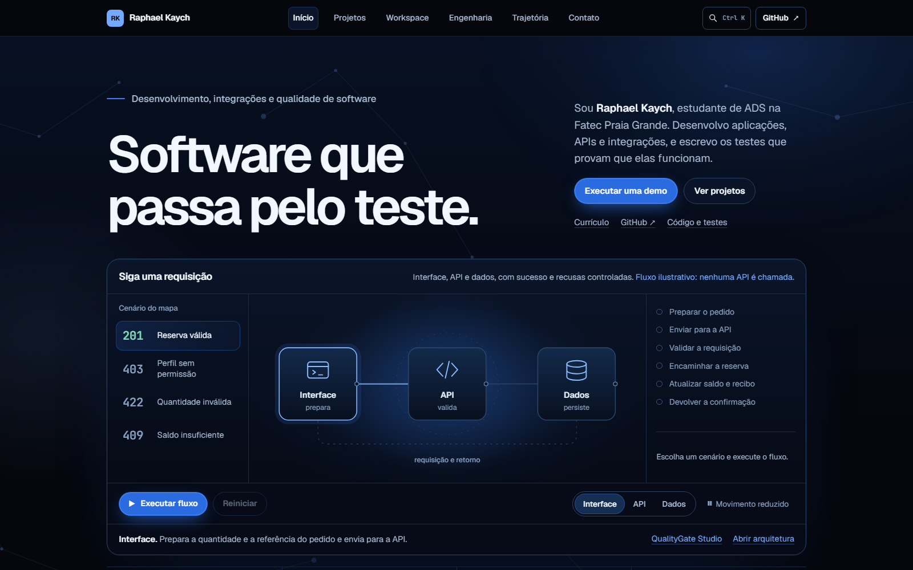
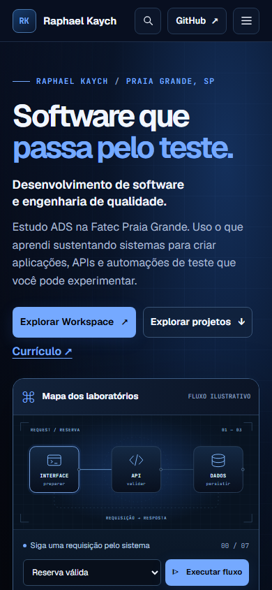
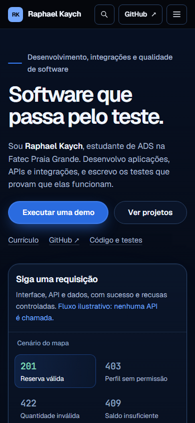
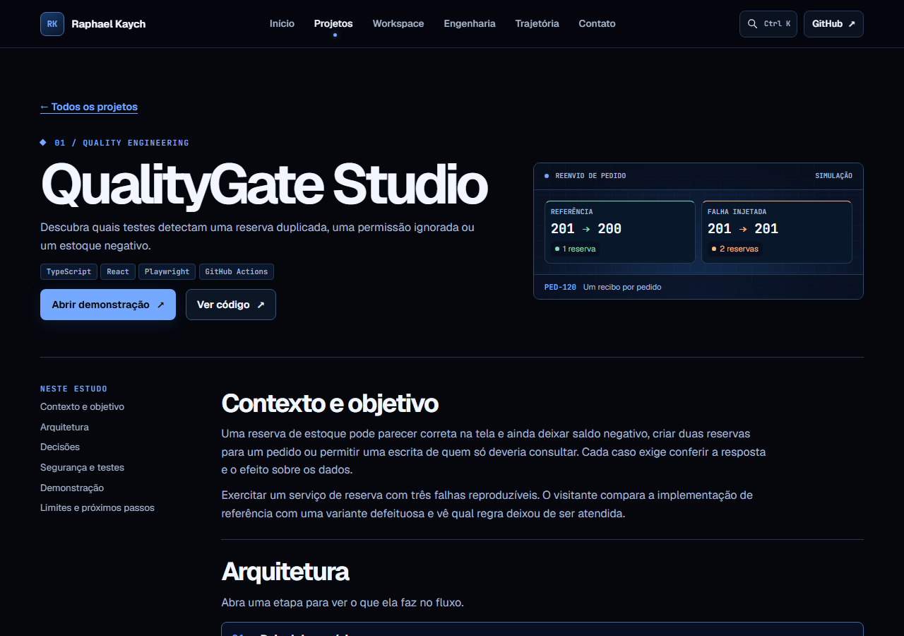
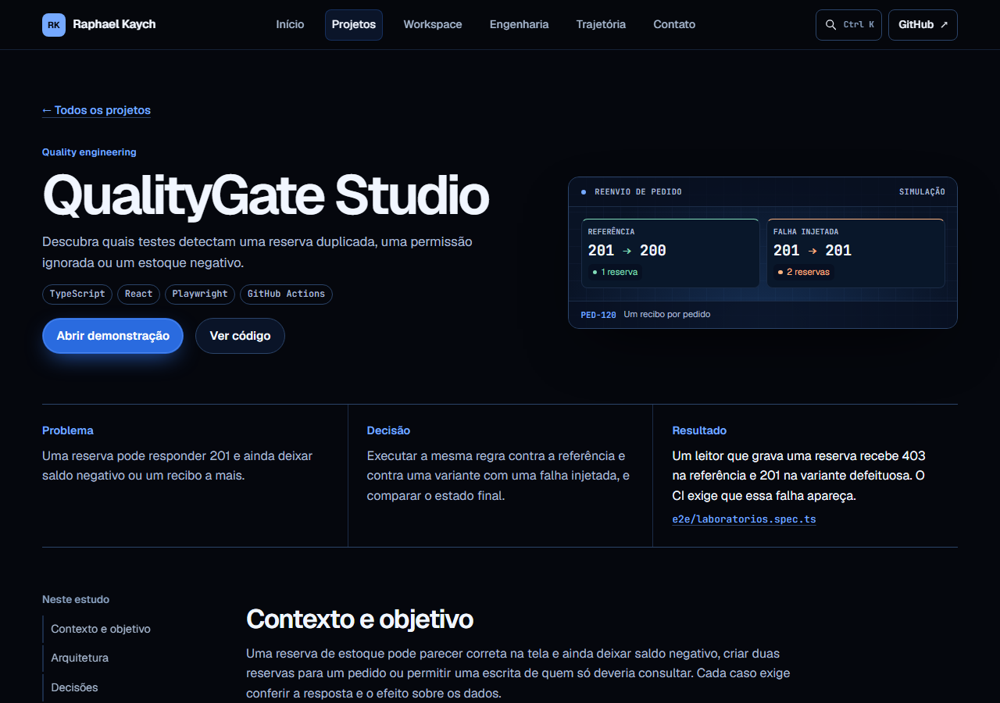
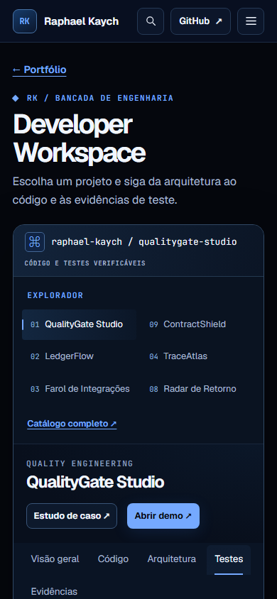
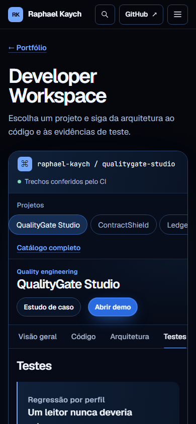

# Redesign: a bancada de requisição

Repaginação do portfólio sobre a base `17c7b24`. Rotas públicas, contratos de API, cenários fictícios, binding D1 `DB` e migrações foram preservados. Nenhuma dependência foi adicionada.

## Direção

Três estudos rápidos sobre a mesma abertura:

| Estudo | Composição | Decisão |
| --- | --- | --- |
| A | Texto à esquerda, bancada compacta à direita (versão anterior) | A bancada ficava estreita demais para mostrar etapas e resultado ao mesmo tempo. |
| B | Título editorial em uma linha de leitura, bancada em largura total logo abaixo | **Escolhido.** O visitante lê quem sou em poucos segundos e a primeira tela já mostra uma requisição sendo testada. |
| C | Bancada como fundo da página, texto por cima | Mais cinematográfico, mas o texto competia com o diagrama e o celular perdia a interação. |

A metáfora que atravessa o site é a requisição: Interface, API, Dados e retorno, com o código HTTP como elemento tipográfico (201, 403, 422, 409). A mesma ideia organiza os projetos (problema, decisão, resultado verificável), os estudos de caso e o Workspace.

## Identidade

- Midnight Navy preservado: `#377FFB`, `#75A9FF`, `#05070D`, `#080F20`, `#102444`, `#152E52`, texto `#F1F6FF`. O preenchimento do botão principal usa `#2A6BDF`, um passo mais fundo da mesma família, para manter contraste de 4,9:1 com texto branco. `#377FFB` segue em brilho, bordas e sinais.
- Geist em interface e títulos, JetBrains Mono só em código, códigos HTTP e dados. Rótulos decorativos em caixa-alta, numeração que não indica sequência e setas em links internos foram removidos.
- Grids de cartões repetidos deram lugar a linhas editoriais: cada projeto em destaque tem problema, decisão e resultado, com link para o teste que comprova o resultado.

## Referências

- [Nimbra](https://demo.codeandchill.store/nimbra/), indicado pelo proprietário: coreografia de entrada, números que contam até o valor, gráficos que crescem da base, auras em deriva e pontos ao vivo. As técnicas foram reimplementadas sobre o conteúdo do portfólio. Nenhum código, layout ou asset do template foi usado. Ao contrário dele, o conteúdo já chega pronto do servidor e a animação só acontece por cima.
- [Alisson Lima](https://www.alissonlimadev.com/): atmosfera e resposta ao ponteiro. Aqui a rede de sinais e as auras usam a família de azul do portfólio.
- Do ciclo anterior, ainda válidas: [Linear](https://linear.app/now/behind-the-latest-design-refresh) para hierarquia editorial e [Resend](https://resend.com/changelog/email-events-timeline) para cronologia de eventos, base da lista de etapas da bancada.

## Movimento

- Uma coreografia de abertura: título digitado, apresentação e ações assentando, a bancada se monta (cenários, nós do diagrama, números). Tudo em `transform` e `opacity`, sem esconder conteúdo do servidor.
- Os números da abertura vêm de `lib/test-inventory.json`, gerado a partir dos arquivos de teste por `scripts/workspace-evidence.mjs` e conferido no CI. Eles contam a partir de zero na primeira vez que aparecem.
- Na rolagem, cada projeto em destaque chega uma vez e seu preview conta a própria história: barras do rastro crescem, as retentativas aparecem em sequência, a conciliação liga as duas origens.
- A bancada mantém pausa, reinício, percurso por teclado e toque, parada fora da tela e com a aba oculta. Com movimento reduzido, entrega o resultado imediato e não anima nada.
- O estado de ambiente sai do componente para o `data-ambient` do topo da página por um `MutationObserver`, em vez de seletores `:has()` dinâmicos.

## Desempenho

Lighthouse 12.8.2, Chromium 158 headless, mesma máquina Windows 11, perfil móvel padrão (4G simulado, CPU 4×), mediana de três execuções. Prévia local por `node scripts/preview-e2e.mjs` com Brotli.

| Página | Antes (local) | Depois (local) |
| --- | --- | --- |
| Home, celular | 73 · LCP 2,86 s · TBT 972 ms · CLS 0 | **96** · LCP 2,64 s · TBT 97 ms · CLS 0 |
| Workspace, celular | 96 · LCP 2,64 s · TBT 1 ms · CLS 0,001 | **96** · LCP 2,73 s · TBT 0 ms · CLS 0 |
| Home, desktop | 100 · LCP 0,62 s | 100 · LCP 0,63 s |

Na produção atual, no mesmo ambiente, a home mediu 69 no celular, com LCP de 2,28 s e TBT de 2.170 ms.

O trace da versão anterior mostrou 2,5 s de estilo e layout contra 0,35 s de execução de script. O Workspace, com a mesma pilha React, ficava em TBT de 1 ms, então o custo era da home: máscara e gradientes em área cheia, `backdrop-filter`, `:has()` invalidado a cada mudança da bancada e animações infinitas em SVG. A nova home tira esses pontos.

O LCP local fica acima de 2,5 s com qualquer versão. O servidor local responde mais devagar que a produção: na base, a produção mediu 0,6 s a menos. A estimativa em produção é de cerca de 2,0 s, a confirmar depois da publicação. A Geist agora tem `preload`, o que tirou o CLS do Workspace e antecipou o FCP. INP precisa de dados de campo.

### Desempenho em produção (Cloudflare)

Na nova hospedagem, o PageSpeed Insights mediu no celular desempenho 98, LCP 1,2 s, TBT 0 ms e CLS 0. As seções abaixo da dobra usam `content-visibility: auto`, e as animações contínuas (pulso dos pontos ao vivo e órbita do diagrama) passaram para `transform` e `opacity`. Isso reduz o estilo e o layout calculados na carga.

## Validação

`npm run lint`, `npm run typecheck`, `npm test`, `node scripts/workspace-evidence.mjs --check`, `npm run build` e `npm run test:e2e` passam localmente e no CI. As capturas de `e2e/visual.spec.ts` mudaram de propósito e foram substituídas pelas do artefato do CI no Linux, depois de revisadas.

- **Outro motor**: smoke test em WebKit 27.2, em 1280 e 390 px, sem erros de página nem rolagem horizontal. A bancada chega ao 403, o Workspace abre por URL profunda e o filtro do catálogo funciona. O Firefox não pôde ser executado nesta máquina, porque o Controle Inteligente de Aplicativos do Windows bloqueia o binário do Playwright.
- **Zoom e telas estreitas**: as 22 rotas do sitemap e a 404 ficam sem rolagem horizontal em 360 px e em 640 px, o equivalente a 200% de zoom numa tela de 1280 px.
- **Compartilhamento**: `compartilhamento.svg`, o PNG gerado a partir dele e o favicon seguem a nova linguagem.

## Publicação e reversão no Sites

1. Revisar e fazer merge do PR em `main`.
2. Sincronizar a fonte do SHA de merge com o repositório gerenciado do Sites, gerar o build empacotado, salvar a versão e publicar. Não há migração nova.
3. Para reverter, republicar no Sites a versão 8, que corresponde a `17c7b24`.

## Antes e depois

| | Antes | Depois |
| --- | --- | --- |
| Home, 1600 px |  |  |
| Home, 390 px |  |  |
| Estudo de caso, 1280 px |  |  |
| Workspace, 390 px |  |  |

Capturas da prévia local em Chromium, com movimento reduzido para mostrar o estado final.
