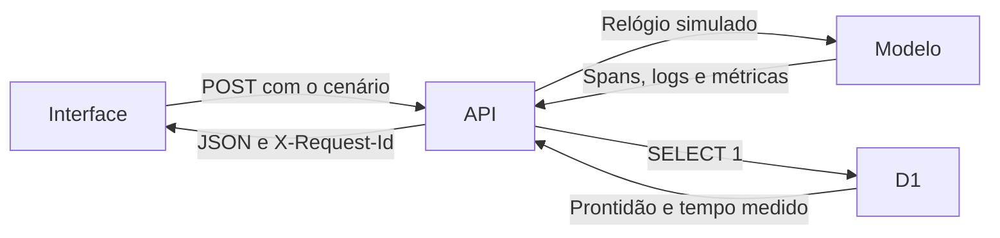

# TraceAtlas

[Demo pública](https://raphael-kaych.raphaelvindex.chatgpt.site/traceatlas) · [Estudo de caso](https://raphael-kaych.raphaelvindex.chatgpt.site/projetos/traceatlas)

O laboratório simula nove pedidos por execução. É possível comparar um fluxo normal, uma consulta lenta, indisponibilidade do banco, falha do worker, indisponibilidade do ERP e recuperação do ERP.

## Investigar uma recuperação

1. Escolha **Recuperação do ERP** e execute o cenário.
2. Ative **Só rastros com falha**. Seis pedidos ficam no recorte, embora os nove tenham sido concluídos. A falha que motivou a retentativa permanece no histórico.
3. Selecione **ERP · Enviar pedido** e confira o código 503. Selecione **ERP · Reenviar pedido** e veja o 200 no mesmo rastro.
4. Abra os logs para conferir a ordem e o identificador das operações. Compare com **ERP fora do ar**, no qual as falhas permanecem no resultado final.

## Fluxo



Cada span tem ID, pai, instante inicial, duração e código. Os tempos simulados permitem reproduzir a mesma árvore entre execuções. Os IDs são únicos por lote e os logs apontam para o span e o rastro. O P95 usa o posto mais próximo. Com nove pedidos ele corresponde à maior duração da amostra.

A rota também mede uma consulta real de prontidão ao D1. O tempo aparece em um painel separado. A resposta inclui um ID de correlação e usa `Cache-Control: no-store`. Os dados simulados existem durante a execução e a visita. A demo usa o mesmo Worker do portfólio e a sonda é somente leitura.

## Executar e verificar

Use o [guia do repositório](../README.md) para iniciar o ambiente com D1 local. O [contrato OpenAPI](../public/api-contract.json) descreve a rota.

```sh
node --test tests/traceatlas.test.ts
npm run test:e2e -- --grep TraceAtlas
```

Os testes validam o parentesco e os limites de tempo em todos os cenários, a distinção entre falha e recuperação, a correlação dos logs, o contrato HTTP e a sonda isolada. Playwright verifica o caminho de investigação em uma tela de 390 px. A evolução prevista é propagar o contexto entre serviços independentes e exportar os spans para um coletor OpenTelemetry.
